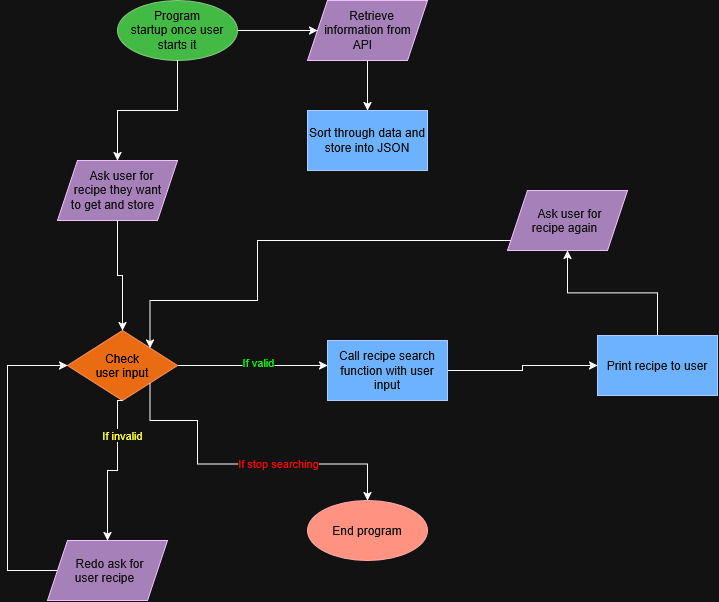

# Recipe Finder

A simple JavaScript program that finds recipes without any hassle.

## The Problem

My original problem was that using recipe websites are very annoying. They often have extra information that is useless and unneeded. So I decided to make a program to fix that.

## How It Works

## Tech Stack
- Language: JavaScript
- Tools: Node.js
- APIs: TheMealDB

## Setup
- Will be completed after program is finished 

## Usage
- Will be completed after program is finished

## Roadmap
- Create basic website
- Add current program as main function as the website
- Make website look good

## Author
Kamalani DeFreitas